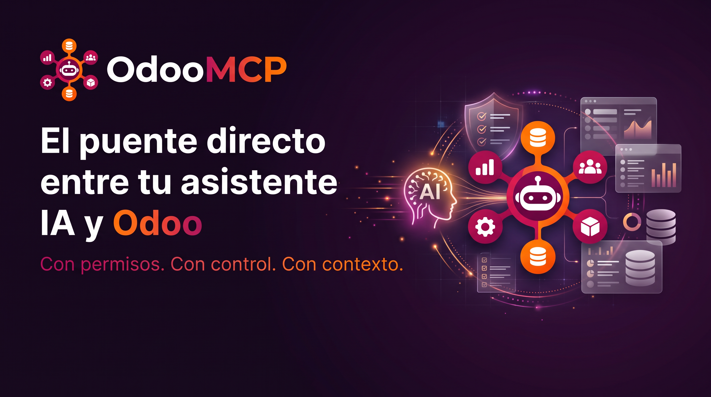
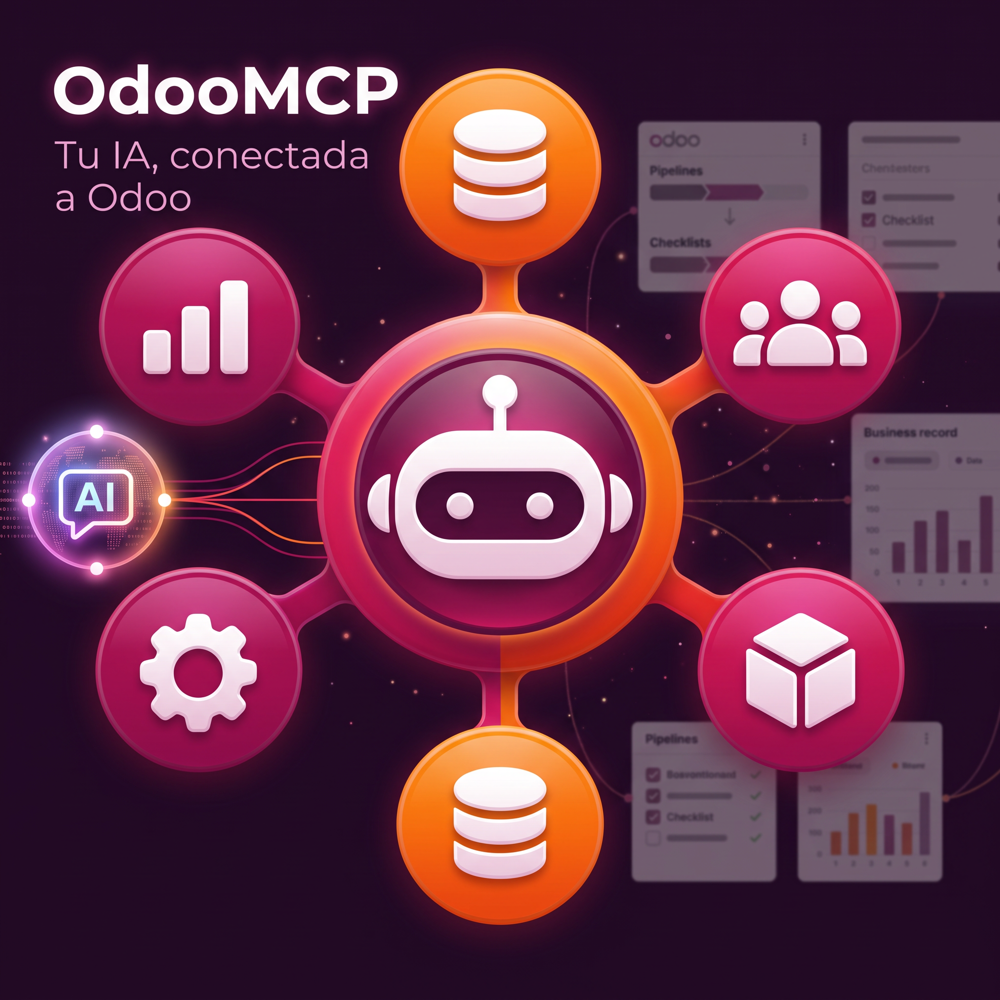

<div align="center">


# OdooMCP

**Un puente directo y respetuoso con los permisos entre los asistentes de IA y Odoo.**

Explora, consulta y actualiza información empresarial, gestiona adjuntos y ejecuta workflows compatibles mediante el Model Context Protocol, desde el cliente de IA que ya utilizas.

[](https://github.com/Pacoaldev/OdooMCP/actions/workflows/ci.yml)  [](https://codecov.io/gh/Pacoaldev/OdooMCP)  [](https://github.com/astral-sh/ruff)  [](https://github.com/astral-sh/ty)  [](https://www.python.org/downloads/)  [](https://opensource.org/licenses/MIT)

[English](README.md) · **Español**

</div>

---

## Mapa de documentación

Esta guía sigue el recorrido de uso del proyecto: empieza estableciendo la conexión, después configura el nivel de acceso adecuado y, por último, consulta las operaciones disponibles.

**01 · Conoce el proyecto y arranca**

- [Qué hace](#qué-hace)
- [Inicio rápido](#inicio-rápido)
- [Conecta tu cliente](#conecta-tu-cliente)
- [Instalaciones alternativas](#instalaciones-alternativas)

**02 · Configura la conexión**

- [Configuración](#configuración)
- [Transportes](#transportes)
- [Configurar Odoo (modo estándar)](#configurar-odoo-modo-estándar)
- [Modo YOLO](#modo-yolo)

**03 · Trabaja con los datos de Odoo**

- [Referencia de herramientas](#referencia-de-herramientas)
- [Selección de campos y contexto por llamada](#selección-de-campos-y-contexto-por-llamada)
- [URIs de recursos](#uris-de-recursos)
- [Cómo funciona](#cómo-funciona)

**04 · Seguridad y mantenimiento**

- [Seguridad](#seguridad)
- [Resolución de problemas](#resolución-de-problemas)

**05 · Desarrollo y comunidad**

- [Desarrollo y pruebas](#desarrollo-y-pruebas)
- [Licencia](#licencia)
- [Contribuir](#contribuir)
- [Apoyo](#apoyo)

---

## Acceso directo por tarea

- **Conecta el servidor:** [Inicio rápido](#inicio-rápido)
- **Elige cómo instalarlo:** [Instalaciones alternativas](#instalaciones-alternativas)
- **Ajusta el acceso:** [Configuración](#configuración)
- **Consulta las herramientas:** [Referencia de herramientas](#referencia-de-herramientas)
- **Revisa la seguridad:** [Seguridad](#seguridad)

## 01 · Conoce el proyecto y arranca

### Qué hace

<p align="center">
  
</p>

Un servidor MCP que traduce peticiones en lenguaje natural de un asistente de IA en
operaciones autenticadas sobre Odoo: lecturas, escrituras, agregaciones, gestión de
ficheros y métodos de workflow. Gestiona la autenticación, el control de acceso,
la selección de campos, el formateo de datos y el tratamiento de errores, y presenta los
datos de Odoo en un formato jerárquico optimizado para LLMs.

Cosas que puedes pedirle a tu asistente una vez conectado:

- "Muéstrame todos los clientes de España"
- "Busca productos con existencias por debajo de 10 unidades"
- "Lista los pedidos de venta de hoy por encima de 1000 $"
- "Crea un nuevo contacto de cliente para Acme Corporation"
- "Actualiza el teléfono del cliente John Doe a +1-555-0123"
- "Cambia el estado del pedido SO/2024/001 a confirmado"
- "Elimina el contacto de prueba que creamos antes"

### Mapa de funcionalidades

| Área | Qué obtienes |
|------|--------------|
| CRUD | Buscar, leer, contar, crear, actualizar y eliminar en los modelos habilitados |
| Operaciones masivas | Creación/actualización por lotes de hasta 100 registros en una única transacción atómica |
| Analítica | Agrupación y sumas en el servidor (`formatted_read_group` en Odoo 19+, con fallback a `read_group`) |
| Ficheros | Leer y subir adjuntos y campos binarios; publicar en el chatter del registro |
| Contexto de sesión | Usuario conectado, zona horaria y empresas activas inyectadas en las instrucciones de sesión |
| Inteligencia | Selección inteligente de campos, ocultación de campos con credenciales, salida optimizada para LLMs |
| Control de acceso | Autenticación por clave API o usuario/contraseña, lista de modelos permitidos, contexto de empresa/idioma por llamada |
| Localización | Respuestas en tu idioma de Odoo preferido (`ODOO_LOCALE`, `lang` por llamada) |
| Compatibilidad | Funciona con cualquier instancia de Odoo en modo YOLO; con el módulo MCP para producción (Odoo 16–20) |
| Migración | Escaneo estático de addons personalizados frente a roturas en Odoo 20 (`migration_rules`, `migration_scan`) |

### Inicio rápido

1. Instala [UV](https://docs.astral.sh/uv/) en la máquina donde ejecutas tu cliente de IA:

   ```bash
   # macOS / Linux
   curl -LsSf https://astral.sh/uv/install.sh | sh

   # Windows (PowerShell)
   powershell -c "irm https://astral.sh/uv/install.ps1 | iex"
   ```

2. Apunta tu cliente al servidor con tus credenciales de Odoo:

   ```json
   {
     "mcpServers": {
       "odoo": {
         "command": "uvx",
         "args": ["mcp-odoo"],
         "env": {
           "ODOO_URL": "https://your-odoo-instance.com",
           "ODOO_API_KEY": "your-api-key-here"
         }
       }
     }
   }
   ```

3. Reinicia tu terminal para que UV esté en el `PATH` y empieza a preguntar.

Dos formas de hablar con Odoo:

- **Modo estándar (producción)**: Odoo 16.0+ con el
  [módulo MCP de Odoo](https://apps.odoo.com/apps/modules/19.0/mcp_server) instalado.
  Permisos a nivel de modelo, acceso auditado.
- **Modo YOLO (desarrollo/pruebas/demos)**: se conecta a cualquier Odoo estándar con
  XML-RPC habilitado. No requiere módulo. Omite los controles de acceso MCP — consulta
  el [modo YOLO](#modo-yolo).

### Conecta tu cliente

El servidor se ejecuta en la máquina donde está instalado el cliente de IA, no en el
servidor de Odoo. Todos los clientes de abajo usan el mismo comando, argumentos y
variables de entorno — solo cambia la ubicación del fichero de configuración.

<details>
<summary>Claude Desktop</summary>

Añade a `~/Library/Application Support/Claude/claude_desktop_config.json`:

```json
{
  "mcpServers": {
    "odoo": {
      "command": "uvx",
      "args": ["mcp-odoo"],
      "env": {
        "ODOO_URL": "https://your-odoo-instance.com",
        "ODOO_API_KEY": "your-api-key-here",
        "ODOO_DB": "your-database-name"
      }
    }
  }
}
```
</details>

<details>
<summary>Claude Code</summary>

Añade al fichero `.mcp.json` en la raíz de tu proyecto, o ejecuta:

```bash
claude mcp add odoo \
  --env ODOO_URL=https://your-odoo-instance.com \
  --env ODOO_API_KEY=your-api-key-here \
  --env ODOO_DB=your-database-name \
  -- uvx mcp-odoo
```
</details>

<details>
<summary>Cursor</summary>

Añade a `~/.cursor/mcp.json`:

```json
{
  "mcpServers": {
    "odoo": {
      "command": "uvx",
      "args": ["mcp-odoo"],
      "env": {
        "ODOO_URL": "https://your-odoo-instance.com",
        "ODOO_API_KEY": "your-api-key-here",
        "ODOO_DB": "your-database-name"
      }
    }
  }
}
```
</details>

<details>
<summary>VS Code (con GitHub Copilot)</summary>

Añade a `.vscode/mcp.json` en tu workspace. Fíjate en que VS Code usa
`"servers"` como clave raíz, no `"mcpServers"`:

```json
{
  "servers": {
    "odoo": {
      "type": "stdio",
      "command": "uvx",
      "args": ["mcp-odoo"],
      "env": {
        "ODOO_URL": "https://your-odoo-instance.com",
        "ODOO_API_KEY": "your-api-key-here",
        "ODOO_DB": "your-database-name"
      }
    }
  }
}
```
</details>

<details>
<summary>Windsurf</summary>

Añade a `~/.codeium/windsurf/mcp_config.json`:

```json
{
  "mcpServers": {
    "odoo": {
      "command": "uvx",
      "args": ["mcp-odoo"],
      "env": {
        "ODOO_URL": "https://your-odoo-instance.com",
        "ODOO_API_KEY": "your-api-key-here",
        "ODOO_DB": "your-database-name"
      }
    }
  }
}
```
</details>

<details>
<summary>Zed</summary>

Añade a `~/.config/zed/settings.json`:

```json
{
  "context_servers": {
    "odoo": {
      "command": {
        "path": "uvx",
        "args": ["mcp-odoo"],
        "env": {
          "ODOO_URL": "https://your-odoo-instance.com",
          "ODOO_API_KEY": "your-api-key-here",
          "ODOO_DB": "your-database-name"
        }
      }
    }
  }
}
```
</details>

### Instalaciones alternativas

<details>
<summary>Docker</summary>

Ejecuta con Docker — no requiere instalación de Python:

```json
{
  "mcpServers": {
    "odoo": {
      "command": "docker",
      "args": [
        "run", "-i", "--rm",
        "-e", "ODOO_URL=http://host.docker.internal:8069",
        "-e", "ODOO_API_KEY=your-api-key-here",
        "Pacoaldev/OdooMCP"
      ]
    }
  }
}
```

> **Nota:** Usa `host.docker.internal` en lugar de `localhost` para conectarte a Odoo si
> se ejecuta en la máquina anfitriona.

Para transporte HTTP:

```bash
docker run --rm -p 8000:8000 \
  -e ODOO_URL=http://host.docker.internal:8069 \
  -e ODOO_API_KEY=your-api-key-here \
  Pacoaldev/OdooMCP --transport streamable-http --host 0.0.0.0
```

> ⚠️ **Seguridad**: el transporte HTTP no tiene autenticación integrada — cualquiera que
> alcance el puerto obtiene acceso a Odoo con las credenciales del servidor. Publica el
> puerto solo en redes de confianza, o ponlo detrás de un proxy inverso con autenticación.
> Consulta [Transportes](#transportes).

La imagen también está disponible en GHCR: `ghcr.io/pacoaldev/odoomcp`
</details>

<details>
<summary>pip / pipx</summary>

```bash
# Instalación global
pip install mcp-odoo

# O usa pipx para un entorno aislado
pipx install mcp-odoo
```

Después usa `odoomcp` como comando en tu configuración MCP.
</details>

<details>
<summary>Desde el código fuente</summary>

```bash
git clone https://github.com/Pacoaldev/OdooMCP.git
cd OdooMCP
pip install -e .
```

Después usa la ruta completa del paquete en tu configuración MCP.
</details>

## 02 · Configura la conexión

### Configuración

#### Variables de entorno obligatorias

| Variable | Obligatoria | Descripción | Ejemplo |
|----------|-------------|-------------|---------|
| `ODOO_URL` | Sí | URL de tu instancia de Odoo | `https://mycompany.odoo.com` |
| `ODOO_API_KEY` | Sí* | Clave API para la autenticación | `<tu-clave-api>` |
| `ODOO_USER` | Sí* | Nombre de usuario (si no usas clave API) | `admin` |
| `ODOO_PASSWORD` | Sí* | Contraseña (si no usas clave API) | `admin` |
| `ODOO_DB` | No | Nombre de la base de datos (se autodetecta si no se indica) | `mycompany` |
| `ODOO_LOCALE` | No | Idioma/locale para las respuestas de Odoo | `es_ES`, `fr_FR`, `de_DE` |
| `ODOO_ALLOWED_COMPANIES` | No | IDs de empresa separados por comas para acotar todas las operaciones (entornos multiempresa) | `1`, `1,3` |
| `ODOO_YOLO` | No | Modo YOLO - omite la seguridad MCP (⚠️ SOLO DESARROLLO) | `off`, `read`, `true` |
| `ODOO_MCP_ENABLE_METHOD_CALLS` | No | Habilita la herramienta `call_model_method` — requiere `ODOO_YOLO=true` (⚠️ Peligroso, consulta [`call_model_method`](#call_model_method)) | `false`, `true` |
| `ODOO_RPC_TRANSPORT` | No | Protocolo RPC en modo YOLO: `auto` (JSON-2 en Odoo 19 y posteriores con clave API, si no XML-RPC), `xmlrpc`, o `json2` para la API JSON-2 de Odoo (Odoo 19 y posteriores, solo clave API) | `auto`, `json2` |

*Se requiere `ODOO_API_KEY`, o bien `ODOO_USER` y `ODOO_PASSWORD` juntos. En modo YOLO
sobre XML-RPC, `ODOO_USER` es obligatorio incluso usando una clave API. Sobre JSON-2 la
clave API basta, porque Odoo lee el usuario a partir de la clave.

**Notas:**
- Si el listado de bases de datos está restringido en tu servidor, debes indicar `ODOO_DB`
- Se recomienda la autenticación por clave API por seguridad
- El servidor también carga variables de entorno desde un fichero `.env` en el directorio de trabajo
- En modo estándar, el servidor guarda en caché los permisos MCP de cada modelo durante
  5 minutos. Si eliminas un permiso en Odoo, la siguiente llamada se rechaza de inmediato,
  porque el módulo MCP comprueba cada llamada. Si concedes un permiso, puede tardar hasta
  5 minutos en aplicarse. Reinicia el servidor para aplicarlo al instante.

#### Variables avanzadas

| Variable | Por defecto | Descripción |
|----------|-------------|-------------|
| `ODOO_MCP_DEFAULT_LIMIT` | `25` | Número de registros devueltos por búsqueda por defecto |
| `ODOO_MCP_MAX_LIMIT` | `100` | Límite máximo de registros por petición |
| `ODOO_MCP_MAX_SMART_FIELDS` | `15` | Máximo de campos devueltos por la selección inteligente |
| `ODOO_MCP_LOG_LEVEL` | `INFO` | Nivel de log (`DEBUG`, `INFO`, `WARNING`, `ERROR`, `CRITICAL`) |
| `ODOO_MCP_LOG_JSON` | `false` | Habilita salida de logs JSON estructurados |
| `ODOO_MCP_LOG_FILE` | — | Ruta del fichero de log rotativo (10 MB, 5 copias) |
| `ODOO_MCP_LOG_FORMAT` | — | Cadena de formato de logging de Python personalizada (por defecto: `%(asctime)s - %(name)s - %(levelname)s - %(message)s`) |
| `ODOO_MCP_SLOW_OPERATION_THRESHOLD_MS` | `1000` | Umbral en milisegundos a partir del cual una operación se registra como lenta |
| `ODOO_MCP_TRANSPORT` | `stdio` | Tipo de transporte (`stdio`, `streamable-http`) |
| `ODOO_MCP_HOST` | `localhost` | Host de escucha para el transporte HTTP |
| `ODOO_MCP_PORT` | `8000` | Puerto de escucha para el transporte HTTP |
| `ODOO_MCP_ALLOWED_HOSTS` | — | Cabeceras `Host` aceptadas, separadas por comas, para el transporte HTTP (protección contra DNS rebinding). Configúralo cuando ejecutes `streamable-http` detrás de un proxy inverso que reenvía un host externo, p. ej. `odoo.example.com,localhost`. Los literales IPv6 pueden ir con o sin corchetes (`[::1]:8000`, `::1`). **Sin configurar, la protección solo se activa automáticamente en una escucha en loopback** — cualquier otro host (p. ej. `0.0.0.0`) se ejecuta sin validación alguna de `Host`/`Origin`. |
| `ODOO_MCP_SESSION_IDLE_TIMEOUT` | — | Segundos de inactividad antes de cerrar una sesión `streamable-http` y liberar su estado en el servidor, p. ej. `600`. Sin configurar, las sesiones nunca expiran. |
| `ODOO_MCP_MAX_BINARY_SIZE` | `52428800` | Máximo de bytes devueltos por una única lectura `resources/read` de un binario/adjunto. Se comprueba antes de obtener el payload (para campos de registro, un probe `bin_size` en Odoo 19 y anteriores, y el tamaño del adjunto asociado o un recuento `field.size` en Odoo 20; para adjuntos, el `file_size` almacenado), así que una lectura demasiado grande se rechaza con un error limpio en lugar de cargarse en memoria y recodificarse a base64. En Odoo 20, un campo binario no almacenado (como `avatar_128`), o uno almacenado cuyo adjunto el usuario no puede leer, se comprueba solo después de la lectura. |
| `ODOO_MCP_ADDONS_PATH` | — | Directorios con tus módulos personalizados, separados por el separador de rutas del sistema (`;` en Windows, `:` en otros). Habilita la herramienta `migration_scan`; si se deja vacío, la herramienta no se registra. P. ej. `C:\addons\custom` o `/opt/addons:/opt/extra`. |
| `ODOO_MCP_MIGRATION_TARGET` | `20.0` | Serie de Odoo a la que apuntan las reglas de migración, p. ej. `20.0`, o `21.0` para planificar la siguiente actualización. |

#### Acotación multiempresa (`ODOO_ALLOWED_COMPANIES`)

En bases de datos multiempresa, la empresa por defecto del usuario autenticado se aplica
a cada registro que el servidor crea, y la visibilidad de registros abarca todas las
empresas permitidas del usuario. Configurar `ODOO_ALLOWED_COMPANIES` inyecta
`allowed_company_ids` en el contexto de cada llamada RPC, de modo que las reglas de
registro, `env.company` y los valores por defecto de creación quedan limitados a las
empresas listadas. Un patrón útil es configurar una entrada de servidor MCP por empresa,
compartiendo un único usuario de Odoo:

```json
{
  "mcpServers": {
    "odoo-company-a": {
      "command": "uvx",
      "args": ["mcp-odoo"],
      "env": { "ODOO_URL": "...", "ODOO_API_KEY": "...", "ODOO_ALLOWED_COMPANIES": "1" }
    },
    "odoo-company-b": {
      "command": "uvx",
      "args": ["mcp-odoo"],
      "env": { "ODOO_URL": "...", "ODOO_API_KEY": "...", "ODOO_ALLOWED_COMPANIES": "3" }
    }
  }
}
```

Al arrancar, el servidor comprueba que cada ID pertenece a las empresas del usuario, y no
arranca en caso contrario. Si el usuario no puede leer su propio registro `res.users`
(modo estándar sin `res.users` habilitado), la comprobación se omite con un aviso, y
Odoo rechaza una empresa ajena en cada llamada. El primer ID es la empresa activa: Odoo
lo usa para los valores por defecto de creación, y `get_current_context` y las
instrucciones de sesión lo muestran. Una llamada puede reducir el alcance a algunas de
las empresas listadas, pero nunca ampliarlo.

Ten en cuenta que esto es acotación a nivel de contexto, no una frontera de seguridad:
las credenciales pueden seguir accediendo a todas las empresas que el usuario de Odoo
tenga permitidas. Para un aislamiento estricto, restringe las empresas permitidas del
usuario en el propio Odoo.

### Transportes

#### stdio (por defecto)

Entrada/salida estándar — lo que usan las aplicaciones de IA de escritorio como Claude
Desktop. Sin configuración adicional:

```bash
uvx mcp-odoo
```

#### streamable-http

Transporte HTTP para conectividad remota y acceso de tipo REST.

> ⚠️ **Seguridad**: este transporte **no tiene autenticación de cliente integrada**.
> Cualquier cliente que alcance el puerto puede usar todas las herramientas y recursos
> con las credenciales de Odoo que posee el servidor — incluidas escrituras en modo YOLO
> de acceso total. Mantén la escucha por defecto en `localhost` salvo que la red sea de
> confianza, y pon delante un proxy inverso con autenticación (p. ej. nginx con basic
> auth u OAuth) para el acceso remoto. El servidor registra un aviso al escuchar en un
> host que no es loopback.

```bash
# Ejecutar con transporte HTTP (solo localhost — valor seguro por defecto)
uvx mcp-odoo --transport streamable-http --port 8000

# Escuchar en 0.0.0.0 expone el servidor a la red — consulta la nota de seguridad anterior
uvx mcp-odoo --transport streamable-http --host 0.0.0.0 --port 8000

# O usa variables de entorno
export ODOO_MCP_TRANSPORT=streamable-http
export ODOO_MCP_HOST=0.0.0.0
export ODOO_MCP_PORT=8000
uvx mcp-odoo
```

El endpoint HTTP estará disponible en: `http://localhost:8000/mcp/`

> **Nota**: el transporte SSE (Server-Sent Events) quedó obsoleto en la versión 2025-03-26
> del protocolo MCP. Usa streamable-http en su lugar.

> **Nota**: el transporte HTTP rechaza cuerpos de petición de más de 4 MiB con HTTP 413.
> Mantiene como máximo 10.000 sesiones abiertas y responde a las nuevas con HTTP 503 por
> encima de ese límite. Si `ODOO_MCP_SESSION_IDLE_TIMEOUT` no está configurado, las
> sesiones nunca expiran, así que configúralo en un servidor público de larga duración.

<details>
<summary>Ejecutar el transporte streamable-http para acceso remoto</summary>

```json
{
  "mcpServers": {
    "odoo-remote": {
      "command": "uvx",
      "args": ["mcp-odoo", "--transport", "streamable-http", "--port", "8080"],
      "env": {
        "ODOO_URL": "https://your-odoo-instance.com",
        "ODOO_API_KEY": "your-api-key-here",
        "ODOO_DB": "your-database-name"
      }
    }
  }
}
```
</details>

### Configurar Odoo (modo estándar)

1. **Instala el módulo MCP**:
   - Descarga el módulo [mcp_server](https://apps.odoo.com/apps/modules/19.0/mcp_server)
   - Instálalo en tu instancia de Odoo
   - Ve a Ajustes > MCP Server

2. **Habilita modelos para el acceso MCP**:
   - Ve a Ajustes > MCP Server > Enabled Models
   - Añade los modelos que quieras consultar (p. ej., res.partner, product.product)
   - Configura los permisos (leer, escribir, crear, eliminar) por modelo

3. **Genera una clave API**:
   - Ve a Ajustes > Usuarios y empresas > Usuarios
   - Selecciona tu usuario
   - En la pestaña "Claves API", crea una clave nueva
   - En Odoo 20, asigna a la clave el ámbito RPC (`rpc`). Odoo 20 solo acepta una clave en
     sus rutas RPC con ese ámbito.
   - Copia la clave para tu configuración MCP

4. **Concede acceso MCP al usuario**:
   - Añade el usuario al grupo MCP User en los derechos de acceso del usuario
   - Las versiones recientes del módulo rechazan claves API y contraseñas de usuarios que
     no estén en ese grupo. El servidor informará entonces del motivo que indique el
     módulo al arrancar.

### Modo YOLO

El modo YOLO permite al servidor conectarse directamente a cualquier instancia estándar
de Odoo **sin el módulo MCP**. Omite todos los controles de acceso MCP y está pensado
**SOLO para desarrollo, pruebas y demos**.

**No uses nunca el modo YOLO en producción.**

#### Niveles

| Nivel | Variable | Permite | Bloquea | Uso |
|-------|----------|---------|---------|-----|
| Solo lectura | `ODOO_YOLO=read` | Todas las lecturas (search, read, count) | Toda escritura; muestra indicadores READ-ONLY | Demos, pruebas |
| Acceso total | `ODOO_YOLO=true` | Todo — CRUD completo en todos los modelos | Nada; muestra avisos FULL ACCESS | Solo entornos aislados |

#### Ejemplos de configuración

<details>
<summary>Modo YOLO de solo lectura (más seguro para demos)</summary>

```json
{
  "mcpServers": {
    "odoo-demo": {
      "command": "uvx",
      "args": ["mcp-odoo"],
      "env": {
        "ODOO_URL": "http://localhost:8069",
        "ODOO_USER": "admin",
        "ODOO_PASSWORD": "admin",
        "ODOO_DB": "demo",
        "ODOO_YOLO": "read"
      }
    }
  }
}
```
</details>

<details>
<summary>Modo YOLO de acceso total (⚠️ úsalo con extrema precaución)</summary>

```json
{
  "mcpServers": {
    "odoo-test": {
      "command": "uvx",
      "args": ["mcp-odoo"],
      "env": {
        "ODOO_URL": "http://localhost:8069",
        "ODOO_USER": "admin",
        "ODOO_PASSWORD": "admin",
        "ODOO_DB": "test",
        "ODOO_YOLO": "true"
      }
    }
  }
}
```
</details>

#### Cuándo usarlo

Buen encaje: desarrollo local con datos de prueba, demos rápidas con datos no
sensibles, probar clientes MCP antes de instalar el módulo, prototipado en entornos
aislados.

Nunca: entornos de producción, instancias con datos reales de clientes, servidores de
desarrollo compartidos, cualquier entorno con información sensible.

#### Notas de seguridad

- Se conecta directamente a los endpoints XML-RPC estándar de Odoo, o a JSON-2
  (`/json/2`) en Odoo 19 y posteriores con una clave API (consulta `ODOO_RPC_TRANSPORT`)
- Omite todos los controles de acceso MCP y las restricciones de modelos
- No se aplica limitación de peticiones
- Todas las operaciones se registran en el log pero no se restringen
- El listado de modelos muestra más de 200 modelos en lugar de solo los habilitados
- En modo YOLO completo (`true`), las herramientas de creación, actualización y
  eliminación alcanzan todos los modelos, incluidas las acciones programadas (`ir.cron`)
  y las acciones de servidor (`ir.actions.server`). `call_model_method` se niega a
  ejecutarlas directamente, pero una acción modificada se ejecuta en su próxima
  programación o disparador. Es el mismo poder que tiene un administrador en la interfaz
  de Odoo.

## 03 · Trabaja con los datos de Odoo

<p align="center">
  
</p>

### Referencia de herramientas

| Herramienta | Propósito |
|-------------|-----------|
| `search_records` | Buscar registros en cualquier modelo con filtros, selección de campos y paginación |
| `get_record` | Obtener un registro por su ID |
| `get_fields` | Describir el esquema de un modelo: tipos, etiquetas, relaciones, opciones de selección |
| `list_models` | Listar los modelos habilitados para acceso MCP |
| `list_resource_templates` | Listar los patrones de URI de recursos que expone el servidor |
| `get_current_context` | Mostrar el usuario de sesión, zona horaria, empresas activas y guía de fechas |
| `aggregate_records` | Agrupación y agregación en el servidor (recuentos, sumas, agrupaciones) |
| `create_record` / `create_records` | Crear un registro, o hasta 100 en una única transacción atómica |
| `update_record` / `update_records` | Actualizar un registro, o hasta 100 (valores iguales o por registro) |
| `delete_record` | Eliminar un registro |
| `read_attachment` | Leer un fichero: texto, texto extraído de PDF/Office, imagen en línea o enlace de descarga |
| `list_record_attachments` | Listar los ficheros adjuntos a un registro, del más reciente al más antiguo |
| `upload_attachment` | Adjuntar un fichero a un registro (base64, hasta unos 2,9 MB) |
| `post_message` | Publicar un mensaje en el chatter de un registro (`mail.thread`) |
| `migration_rules` | Listar las reglas de migración que reporta el scanner (Odoo 19 → 20) |
| `migration_scan` | Escanear módulos personalizados en disco buscando incompatibilidades con Odoo (requiere `ODOO_MCP_ADDONS_PATH`) |
| `call_model_method` | Escape hatch opcional para métodos de workflow (solo YOLO completo) |

#### Lectura de datos

##### `search_records`

```json
{
  "model": "res.partner",
  "domain": [["is_company", "=", true], ["country_id.code", "=", "ES"]],
  "fields": ["name", "email", "phone"],
  "limit": 10
}
```

**Selección de campos:**
- Omite `fields` o ponlo a `null`: selección inteligente de campos habituales
- Indica una lista de campos: solo esos campos
- Una lista vacía `[]` se trata como `null` (valores inteligentes por defecto)
- `["__all__"]`: todos los campos (con precaución) — los campos con credenciales se
  ocultan y se listan en el `note` de la respuesta; solicítalos explícitamente por
  nombre si los necesitas

##### `get_record`

```json
{
  "model": "res.partner",
  "record_id": 42,
  "fields": ["name", "email", "street", "city"]
}
```

Mismas reglas de selección de campos que `search_records`. Las respuestas incluyen
también `related_summaries`: nombres para mostrar de las colecciones one2many/many2many
con 5 IDs como máximo, de modo que las relaciones pequeñas se leen sin búsquedas extra.

##### `get_fields`

Describe los campos de un modelo — tipo, etiqueta, obligatorio/solo lectura, destino de
la relación y opciones de selección. Úsalo para descubrir el esquema de un modelo antes
de leer o escribir registros. Omite `attributes` para el conjunto curado por defecto
(`type`, `string`, `required`, `readonly`, `relation`, `selection`); una lista explícita
sustituye al conjunto curado — incluye los valores por defecto en tu lista si aún los
necesitas (p. ej. `["type", "string", "help", "store"]`). Omite `field_names` para una
vista breve: los 60 campos de valor más relevantes, más todos los campos one2many,
many2many, de fichero y HTML, con las listas de selección recortadas a 20 valores. La
respuesta incluye entonces `omitted`, el número de campos dejados fuera, y un `note`.
Pasa `["__all__"]` para todos los campos, o nombra los que necesites. Estas dos formas no
recortan las listas de selección. Una lista vacía `[]` en cualquiera de los dos
parámetros se trata como si se omitiera.

```json
{
  "model": "res.partner",
  "field_names": ["name", "email", "parent_id"]
}
```

##### `get_current_context`

Devuelve el contexto de sesión actual: el usuario conectado, su zona horaria, la empresa
activa más las demás empresas permitidas, y una guía para el manejo de fechas en UTC.
Útil cuando no estás seguro de qué usuario o empresa ejecuta una petición, o de cómo
interpretar las fechas. Los clientes que cumplen la especificación también reciben este
contexto en las instrucciones de la respuesta `initialize`.

```json
{}
```

##### `list_models`

Lista todos los modelos habilitados para acceso MCP.

```json
{}
```

##### `list_resource_templates`

Lista las plantillas de URI de recursos disponibles y sus patrones.

```json
{}
```

##### `aggregate_records`

Agregación en el servidor. Úsala siempre que la pregunta sea "totales/recuentos/
agrupaciones" en lugar de "lista de registros" — empuja el trabajo a PostgreSQL en vez de
extraer filas crudas. Despacha a `formatted_read_group` en Odoo 19+ (el nuevo método
dedicado) y recurre a `read_group` con normalización de la respuesta en versiones
anteriores. Quien llama ve una forma de respuesta consistente en todas las versiones
soportadas. Cuando se omite `aggregates`, se usa `["__count"]` por defecto, de modo que
cada grupo lleva siempre un recuento. Cuando existen más grupos más allá de la página
solicitada, la respuesta pone `has_more: true` y un `next_hint` con el offset de
seguimiento.

```json
{
  "model": "sale.order",
  "groupby": ["date_order:month"],
  "aggregates": ["amount_total:sum"],
  "domain": [["state", "in", ["sale", "done"]]]
}
```

```json
{
  "model": "res.partner",
  "groupby": ["country_id"]
}
```

#### Escritura de datos

##### `create_record`

```json
{
  "model": "res.partner",
  "values": {
    "name": "New Customer",
    "email": "customer@example.com",
    "is_company": true
  }
}
```

##### `create_records`

Crea varios registros de un modelo en una sola llamada. Acepta 100 registros como
máximo. Es una única transacción: o se crean todos o no se crea ninguno.

```json
{
  "model": "res.partner",
  "records": [
    {"name": "Customer A", "email": "a@example.com"},
    {"name": "Customer B", "email": "b@example.com"}
  ]
}
```

##### `update_record`

```json
{
  "model": "res.partner",
  "record_id": 42,
  "values": {
    "phone": "+1234567890",
    "website": "https://example.com"
  }
}
```

##### `update_records`

Actualiza varios registros de un modelo en una sola llamada, con 100 registros
distintos como máximo. Si algún ID no existe, no se escribe nada. Los registros
archivados pueden actualizarse, por ejemplo para desarchivarlos con `"active": true`.
Usa una de dos formas.

Los mismos valores para todos los registros, en cualquier versión de Odoo:

```json
{
  "model": "res.partner",
  "record_ids": [42, 43, 44],
  "values": {
    "category_id": [[4, 7]]
  }
}
```

Valores distintos por registro, en una única transacción, en Odoo 19 y posteriores:

```json
{
  "model": "res.partner",
  "updates": [
    {"id": 42, "values": {"phone": "+1 555 0100"}},
    {"id": 43, "values": {"phone": "+1 555 0101"}}
  ]
}
```

La segunda forma usa `web_save_multi` de Odoo. En modo estándar, el módulo MCP de Odoo
debe permitir ese método.

##### `delete_record`

```json
{
  "model": "res.partner",
  "record_id": 42
}
```

#### Archivos y adjuntos

##### `read_attachment`

Lee un fichero: un adjunto o un campo binario como una imagen. Pasa exactamente uno de
`uri` (una URI `odoo://attachment/{id}` o `odoo://{model}/record/{id}/{field}` de un
resultado de herramienta) o `attachment_id`. El resultado depende del fichero:

- ficheros de texto: su texto, hasta 100.000 caracteres
- ficheros PDF y Office: el texto que Odoo extrajo de ellos (Odoo extrae texto de PDF
  solo con el módulo `attachment_indexation`)
- imágenes PNG, JPEG, GIF y WebP de hasta 256 KB: la propia imagen
- cualquier otra cosa: un enlace de descarga para una persona con sesión iniciada en Odoo

```json
{
  "uri": "odoo://res.partner/record/42/image_1920"
}
```

La mayoría de clientes de chat no leen los recursos MCP por sí solos, así que esta
herramienta es la vía para que el modelo vea un fichero.

##### `list_record_attachments`

Lista los ficheros adjuntos a un registro, del más reciente al más antiguo, con nombre,
mimetype, tamaño, fecha y una URI `odoo://attachment/{id}` para cada uno. Los ficheros
tras campos binarios como `image_1920` no se listan, porque `get_record` los devuelve
como URIs.

```json
{
  "model": "res.partner",
  "record_id": 42
}
```

##### `upload_attachment`

Adjunta un fichero a un registro. `data` es el fichero en base64 plano, con un máximo de
unos 2,9 MB tras la decodificación. Odoo detecta el mimetype cuando no se indica
`mimetype`. El resultado incluye el ID del nuevo adjunto y su URI
`odoo://attachment/{id}`. Para mostrar el fichero en el chatter, pasa el ID a
`post_message` como `attachment_ids`.

```json
{
  "model": "res.partner",
  "record_id": 42,
  "name": "contract.pdf",
  "data": "JVBERi0xLjQK...",
  "mimetype": "application/pdf"
}
```

En modo estándar, el usuario necesita acceso de escritura sobre el modelo del registro y
acceso de creación sobre `ir.attachment`.

#### Colaboración

##### `post_message`

Publica un mensaje en el chatter de un registro (`mail.thread`). `subtype="note"`
(por defecto) es un registro interno; `subtype="comment"` notifica a los seguidores.
Pon `body_is_html=true` para marcado HTML. `subject` opcional fija el asunto del
mensaje; `partner_ids` y `attachment_ids` opcionales referencian partners y adjuntos
existentes.

```json
{
  "model": "res.partner",
  "record_id": 42,
  "body": "Called customer, will follow up Tuesday"
}
```

```json
{
  "model": "sale.order",
  "record_id": 17,
  "body": "<p>Shipping confirmed for Monday</p>",
  "subtype": "comment",
  "body_is_html": true
}
```

#### Escape hatch para workflows

##### `call_model_method`

Escape hatch genérico de XML-RPC `execute_kw` — invoca **métodos de negocio**
públicos, para acciones de workflow no cubiertas por el CRUD (postear factura (action_post),
confirmar pedido de venta, validar albarán, etc.). Disponible **solo** cuando se
configuran a la vez `ODOO_YOLO=true` (YOLO completo) y `ODOO_MCP_ENABLE_METHOD_CALLS=true`;
en caso contrario la herramienta no se registra. Solo se aceptan identificadores Python
ASCII públicos como nombres de método — se rechazan nombres con puntos, guiones, espacios,
no ASCII o prefijo `_`.

Algunas llamadas se bloquean por seguridad incluso en modo YOLO completo:

- **Modelos `ir.actions.*` / `ir.cron`** — sus métodos se ejecutan con privilegios
  elevados (acciones de servidor, tareas planificadas)
- **`run` / `method_direct_trigger`** en cualquier modelo — mismo riesgo de escalada vía
  proxies
- **Primitivas ORM de CRUD/acceso a datos** (`create`, `write`, `unlink`, `read`,
  `search*`, `copy`, `sudo`, ...) — usa las herramientas dedicadas en su lugar
- **Métodos `web_*`** — la familia de acceso a datos del cliente web

Los resultados de listas se truncan a 100 elementos.

Sobre JSON-2 (Odoo 19 y posteriores en modo YOLO con clave API, o
`ODOO_RPC_TRANSPORT=json2`), Odoo solo acepta argumentos con nombre. `arguments` puede
contener entonces solo los IDs de registro, como primer elemento. Pasa cualquier otro
argumento en `keyword_arguments`, por su nombre de parámetro, por ejemplo
`{"partner_ids": [3]}`.

> [!WARNING]
> Esta herramienta puede seguir invocando métodos destructivos de workflow
> (p. ej. `button_draft`, `action_cancel`, `toggle_active`, métodos personalizados).
> Actívala solo en entornos de confianza donde aceptes el radio de impacto. Las record
> rules y ACL de Odoo siguen aplicándose al usuario autenticado.

```json
{
  "model": "account.move",
  "method": "action_post",
  "arguments": [[42]]
}
```

```json
{
  "model": "sale.order",
  "method": "action_confirm",
  "arguments": [[7]],
  "keyword_arguments": {"context": {"lang": "en_US"}}
}
```

### Soporte de migración (Odoo 19 → 20)

El servidor puede analizar módulos personalizados en disco contra una serie de Odoo, para
que la conversación de migración se haga sobre tu código real. El escaneo es de solo
lectura: parsea `__manifest__.py`, los CSV de seguridad, los ficheros Python y XML, y
nunca importa el código analizado ni se conecta a Odoo.

Configura `ODOO_MCP_ADDONS_PATH` (uno o más directorios, separados por el separador de
rutas del sistema) y todos los módulos bajo esas raíces se podrán escanear. Sin ella,
`migration_scan` no se registra. `ODOO_MCP_MIGRATION_TARGET` elige la serie a la que
apuntan las reglas, `20.0` por defecto.

#### `migration_rules`

Lista cada regla que el scanner puede reportar: un id estable (p. ej. `ODOO20001`), una
severidad (`error` — el módulo no se instala o la llamada ya no existe; `warning` — se
instala pero el comportamiento cambia en silencio o la API está deprecada; `info` —
cosmético o solo de assets), el tipo de fichero al que aplica, una explicación y un
enlace a la documentación.

```json
{}
```

#### `migration_scan`

Escanea las raíces de addons configuradas. Cada finding lleva el id de regla, severidad,
explicación, fichero, línea y fragmento; un fichero que no se puede parsear se reporta en
el campo `errors` del módulo en lugar de saltarse en silencio. Opcionalmente limita el
escaneo a los nombres de directorio de módulos, o escanea contra otra serie para
planificar la siguiente actualización.

```json
{
  "modules": ["mi_modulo"],
  "target": "21.0"
}
```

### Selección de campos y contexto por llamada

#### Selección inteligente de campos

Cuando omites el parámetro `fields` (o lo pones a `null`), el servidor selecciona
automáticamente los campos más relevantes de cada modelo con un algoritmo de puntuación:

- **Campos esenciales** como `id`, `name`, `display_name` y `active` se incluyen siempre
- **Campos de negocio relevantes** (estado, importe, email, teléfono, partner, etc.)
  tienen prioridad
- **Campos técnicos** (hilos de mensajes, seguimiento de actividades, metadatos web) se
  excluyen
- **Campos costosos** (binarios, HTML, texto largo) se omiten; los campos calculados no
  almacenados se degradan en prioridad
- **Campos con credenciales** (nombres que acaban en `*password`, `*_pass` como
  `smtp_pass`, `passwd`, `*secret`, `*_token`, `*apikey`, o un compuesto `*_key` como
  `api_key`/`secret_key`) se excluyen de los valores por defecto inteligentes y se
  ocultan en las lecturas `["__all__"]` con una nota explicativa — pedir ese campo
  explícitamente por nombre sigue devolviéndolo

El límite por defecto es de 15 campos por petición. Las respuestas incluyen metadatos que
indican qué campos se devolvieron y cuántos hay en total. Puedes ajustar el límite con
`ODOO_MCP_MAX_SMART_FIELDS` o saltártelo por completo con `fields: ["__all__"]`.

Si Odoo rechaza un campo al usuario conectado, por ejemplo un total contable en un
contacto para un usuario sin derechos contables, una lectura con valores por defecto
inteligentes o `["__all__"]` deja ese campo fuera. La respuesta lo lista en
`skipped_fields` y en la nota. Una lectura con una lista de campos explícita falla con el
error de acceso.

#### Contexto por llamada

`search_records`, `get_record`, `aggregate_records`, `create_record`, `create_records`,
`update_record` y `update_records` aceptan un objeto `context` opcional. Acepta cuatro
claves:

| Clave | Efecto |
|---|---|
| `allowed_company_ids` | Las empresas de la llamada. La primera es la empresa activa, de modo que los campos dependientes de empresa como `standard_price` leen y escriben su valor. |
| `lang` | El idioma de etiquetas y valores traducidos. Se rechaza un idioma que Odoo no tenga instalado. En Odoo 16 y 17 el servidor lo comprueba él mismo; en modo estándar eso requiere tener `res.partner` o `res.lang` habilitados para MCP, en caso contrario solo se acepta `en_US`. |
| `tz` | La zona horaria de la llamada. |
| `active_test` | `false` incluye registros archivados en las búsquedas. |

La herramienta rechaza cualquier otra clave y la nombra. Cada empresa debe ser una de
las empresas del usuario, y una de las de `ODOO_ALLOWED_COMPANIES` cuando está
configurado. El contexto se aplica a la búsqueda, el recuento, la lectura, la
comprobación de existencia y la relectura tras la escritura.

```json
{
  "model": "product.product",
  "record_id": 42,
  "values": {"standard_price": 12.5},
  "context": {"allowed_company_ids": [5]}
}
```

### URIs de recursos

Además de las herramientas, el servidor expone los datos de Odoo como URIs de recursos:

| Patrón de URI | Descripción |
|------------|-------------|
| `odoo://{model}/record/{id}` | Obtener un registro concreto por su ID |
| `odoo://{model}/search` | Buscar registros con los ajustes por defecto (los primeros `ODOO_MCP_DEFAULT_LIMIT` registros, 25 por defecto) |
| `odoo://{model}/count` | Contar todos los registros de un modelo |
| `odoo://{model}/fields` | Obtener las definiciones de campo y los metadatos de un modelo |
| `odoo://{model}/record/{id}/{field}` | Obtener un campo binario/imagen de un registro, servido con el mimeType correcto |
| `odoo://attachment/{id}` | Obtener un `ir.attachment` por ID (los adjuntos de tipo url devuelven su URL como texto) |

**Ejemplos:**
- `odoo://res.partner/record/1` — Obtener el partner con ID 1
- `odoo://product.product/search` — Listar los primeros productos
- `odoo://res.partner/count` — Contar todos los partners
- `odoo://product.product/fields` — Mostrar todos los campos de los productos
- `odoo://res.partner/record/1/image_128` — Obtener el avatar del partner 1
- `odoo://attachment/42` — Descargar el adjunto 42

Los campos binarios poblados en los resultados de `get_record`/`search_records` se
devuelven como estas URIs de recursos en lugar de base64 en línea — lee la URI para
obtener los bytes reales. Los bytes llegan de `resources/read`, o de la herramienta
`read_attachment`, que devuelve ficheros de texto (hasta 1 MB) e imágenes PNG, JPEG, GIF
y WebP (hasta 256 KB) en línea para clientes que no leen recursos.

Las lecturas de recursos de registro y búsqueda ocultan los campos con credenciales del
mismo modo que las lecturas masivas de las herramientas — para leer un campo así,
solicítalo explícitamente por nombre mediante el parámetro `fields` de las herramientas.

Las lecturas de binarios y adjuntos se sirven completas, hasta
`ODOO_MCP_MAX_BINARY_SIZE` (50 MB por defecto). El tamaño se comprueba antes de obtener
el payload, así que un campo o adjunto demasiado grande se rechaza con un error limpio en
lugar de almacenarse en búfer en una respuesta proporcionalmente grande. En Odoo 20, un
campo binario no almacenado, o uno almacenado cuyo adjunto el usuario no puede leer, se
comprueba solo después de la lectura.

> **Nota:** las URIs de recursos no admiten parámetros de consulta (como `?domain=...`).
> Para filtrar, paginar y seleccionar campos, usa la herramienta `search_records`.

### Cómo funciona

<p align="center">
  
</p>

```
Asistente de IA (Claude, Copilot, etc.)
        ↓ Protocolo MCP (stdio o HTTP)
   odoomcp
        ↓ XML-RPC, o JSON-2 en Odoo 19+ en modo YOLO
   Instancia de Odoo
```

## 04 · Seguridad y mantenimiento

### Seguridad

- Usa siempre HTTPS en entornos de producción
- Guarda tus claves API con seguridad y rótalas con regularidad
- Configura el acceso a modelos con cuidado — habilita solo los necesarios
- El módulo MCP respeta los access rights y las record rules integrados de Odoo
- Cada clave API está vinculada a un usuario concreto con sus permisos

#### Cómo aplica el modo estándar la lista de modelos permitidos

En modo estándar, el servidor comprueba la lista de modelos permitidos del módulo MCP
antes de cada llamada. También comprueba los modelos que una llamada alcanza a través de
otro modelo:

- Comandos x2many anidados en `values`. Un comando de creación (`[0, 0, {...}]`) necesita
  acceso de creación en el modelo relacionado, una actualización (`[1, id, {...}]`)
  necesita acceso de escritura, y una eliminación (`[2, id]`) necesita acceso de
  eliminación.
- En un campo one2many, un enlace (`[4, id]`) necesita acceso de escritura en el modelo
  relacionado. Una eliminación del enlace (`[3, id]`, `[5]` o `[6, 0, ids]`) necesita
  acceso de escritura y eliminación, porque Odoo elimina los registros relacionados
  cuando el campo inverso se propaga en cascada. Si el modelo relacionado no permite
  eliminaciones, actualiza en su lugar el campo de enlace del registro relacionado.
- Adjuntos, mensajes, correos, seguidores, actividades, valores de seguimiento y
  notificaciones. Las lecturas devuelven solo las filas de los modelos que permiten
  lectura. Crear, cambiar, mover o eliminar una fila necesita acceso de escritura sobre
  el modelo al que pertenece, también mediante un comando anidado como
  `message_ids: [[1, id, {...}]]`.
- Para crear una actividad, el servidor lee `ir.model` para encontrar el modelo de
  `res_model_id`, de modo que `ir.model` debe ser legible para MCP.
- Lecturas a través de una relación. Una condición sobre una ruta con puntos como
  `user_ids.groups_id.name`, una condición `any` o `not any`, una condición de nombre
  sobre un campo x2many y un `order` a través de una relación necesitan acceso de lectura
  en cada modelo relacionado por el que pasan. Agrupar por un campo x2many necesita
  acceso de lectura en su modelo relacionado. Una condición sobre un many2one por nombre
  (`country_id ilike Germany`) sigue permitiéndose, pero una ruta con puntos dentro de él
  (`country_id.code = DE`) necesita acceso de lectura en el modelo relacionado.

Estas comprobaciones no cubren los campos relacionados escribibles ni los padres
`_inherits`. Por ejemplo, una escritura de `email` en un usuario también escribe en su
partner. Del mismo modo, el nombre, el email, el teléfono y la dirección de una empresa
son campos de su registro de partner: si `res.partner` permite escrituras, pueden
modificarse ahí incluso cuando `res.company` sea de solo lectura. Un valor many2one
cuenta como parte del registro que lo contiene: su nombre se devuelve en lecturas y
agrupaciones, y puedes asignarlo a un registro de un modelo que no esté habilitado. Lo
mismo aplica a un enlace many2many (`[4, id]`, `[3, id]`, `[6, 0, ids]`). Los access
rights y las record rules propios de Odoo se aplican a cada llamada.

### Resolución de problemas

<details>
<summary>Problemas de conexión</summary>

Si obtienes errores de conexión:
1. Comprueba que la URL de Odoo es correcta y accesible
2. Verifica que el módulo MCP está instalado: visita `https://your-odoo.com/mcp/health`
3. Asegúrate de que tu firewall permite conexiones hacia Odoo
</details>

<details>
<summary>Errores de autenticación</summary>

Si la autenticación falla:
1. Comprueba que tu clave API está activa en Odoo
2. Verifica que el usuario tiene los permisos adecuados
3. Prueba a regenerar la clave API
4. Para autenticación usuario/contraseña, asegúrate de que 2FA no está habilitado
5. En Odoo 20, asegúrate de que la clave API tiene el ámbito `rpc`
6. En modo estándar, asegúrate de que el usuario está en el grupo MCP User
</details>

<details>
<summary>Errores de acceso a modelos</summary>

Si no puedes acceder a ciertos modelos:
1. Ve a Ajustes > MCP Server > Enabled Models en Odoo
2. Comprueba que el modelo está en la lista y tiene los permisos adecuados
3. Verifica que tu usuario tiene acceso a ese modelo en la configuración de seguridad de Odoo
</details>

<details>
<summary>Error "spawn uvx ENOENT"</summary>

Este error significa que UV no está instalado o no está en tu PATH:

**Solución 1: Instala UV** (consulta [Inicio rápido](#inicio-rápido))

**Solución 2: Problema de PATH en macOS**
Claude Desktop en macOS no hereda el PATH de tu shell. Prueba:
1. Cierra Claude Desktop por completo (Cmd+Q)
2. Abre Terminal
3. Lanza Claude desde Terminal:
   ```bash
   open -a "Claude"
   ```

**Solución 3: Usa la ruta completa**
Localiza UV y usa la ruta completa:
```bash
which uvx
# Salida de ejemplo: /Users/yourname/.local/bin/uvx
```

Luego actualiza tu configuración:
```json
{
  "command": "/Users/yourname/.local/bin/uvx",
  "args": ["mcp-odoo"]
}
```
</details>

<details>
<summary>Problemas de configuración de base de datos</summary>

Si ves "Access Denied" al listar bases de datos:
- Es normal — algunas instancias de Odoo restringen el listado de bases de datos por seguridad
- Asegúrate de especificar `ODOO_DB` en tu configuración
- El servidor usará la base de datos que indiques sin validarla

Ejemplo de configuración:
```json
{
  "env": {
    "ODOO_URL": "https://your-odoo.com",
    "ODOO_API_KEY": "your-key",
    "ODOO_DB": "your-database-name"
  }
}
```
Nota: `ODOO_DB` es obligatoria si el listado de bases de datos está restringido en tu servidor.
</details>

<details>
<summary>Error "SSL: CERTIFICATE_VERIFY_FAILED"</summary>

Este error se produce cuando Python no puede verificar los certificados SSL, a menudo en
macOS o en redes corporativas.

**Solución**: añade la ruta del certificado SSL a tu configuración de entorno:

```json
{
  "env": {
    "ODOO_URL": "https://your-odoo.com",
    "ODOO_API_KEY": "your-key",
    "SSL_CERT_FILE": "/etc/ssl/cert.pem"
  }
}
```

Esto indica a Python dónde encontrar el bundle de certificados SSL del sistema para las
conexiones HTTPS. La ruta `/etc/ssl/cert.pem` es la ubicación estándar en la mayoría de
sistemas.
</details>

<details>
<summary>Debug Mode</summary>

Habilita el logging de depuración para más información:

```json
{
  "env": {
    "ODOO_URL": "https://your-odoo.com",
    "ODOO_API_KEY": "your-key",
    "ODOO_MCP_LOG_LEVEL": "DEBUG"
  }
}
```
</details>

## 05 · Desarrollo y comunidad

### Desarrollo y pruebas

<details>
<summary>Entorno local de integración con Odoo 19</summary>

El repositorio incluye `docker-compose.yml` y `Dockerfile.odoo` para levantar un entorno
local persistente con Odoo 19, PostgreSQL 16 y el addon `mcp_server`, montado desde
`addons/mcp_server` (incluido en este repo para desarrollo local y validación en Odoo 20).
Cualquier otro módulo que pongas bajo `addons/` sigue excluido de Git.

```bash
# Arranca los servicios; los volúmenes conservan la base de datos y los datos de Odoo
docker compose up -d

# Comprueba que el módulo MCP de Odoo está listo
curl http://localhost:8069/mcp/health
```

Crea un archivo local `.env` en la raíz del repositorio (ya está excluido de Git):

```dotenv
ODOO_URL=http://localhost:8069
ODOO_DB=odoo_test
ODOO_USER=admin
ODOO_PASSWORD=admin
ODOO_API_KEY=<tu clave API de Odoo con scope rpc>
```

`Dockerfile.odoo` instala las dependencias del addon en la imagen; sobreviven a la
recreación del contenedor. La base de datos y el filestore persisten en volúmenes Docker,
y `./addons` se monta desde el equipo anfitrión.

Para ejecutar los tests de integración, exporta las variables antes. Pytest no carga
`.env` automáticamente:

```bash
# Bash
set -a; source .env; set +a
uv run pytest -m "yolo or mcp" -q
```

</details>

<details>
<summary>Stack Odoo 20 (validación del addon)</summary>

Un segundo Compose levanta Odoo **20.0** en el puerto **8070** del anfitrión, en paralelo al
entorno 19.x, sin compartir volúmenes ni puertos:

```bash
docker compose -f docker-compose.odoo20.yml up -d
curl -s -o /dev/null -w "%{http_code}" http://localhost:8070/web/login
```

Ejecuta la suite del addon `mcp_server` dentro del contenedor (puerto HTTP libre para no
chocar con una instancia en marcha):

```bash
docker compose -f docker-compose.odoo20.yml exec odoo20 \
  odoo --stop-after-init --no-http --http-port=8079 \
  --test-enable --test-tags /mcp_server --update mcp_server \
  -d odoo20 --db_host=db20 --db_user=odoo --db_password=odoo --without-demo=true
```

Si todo va bien verás **722** tests con **0** fallos. En Odoo 20 las claves API exigen
**coincidencia exacta de scope** (`rpc` o el scope `mcp` del addon); las claves NULL de 19.x
ya no autentican.

</details>

<details>
<summary>Conectar OpenCode</summary>

Añade este servidor MCP a `opencode.json` de OpenCode:

```json
{
  "mcp": {
    "odoo": {
      "type": "local",
      "command": ["uv", "run", "--directory", "<ruta-a-OdooMCP>", "python", "-m", "mcp_server_odoo"],
      "environment": {
        "ODOO_URL": "http://localhost:8069",
        "ODOO_DB": "odoo_test",
        "ODOO_USER": "admin",
        "ODOO_PASSWORD": "admin",
        "ODOO_API_KEY": "<tu-clave-con-scope-rpc>"
      },
      "enabled": true
    }
  }
}
```

Reinicia OpenCode y pídele que consulte registros de Odoo. Los permisos de modelos
configurados en el módulo MCP de Odoo siguen aplicándose a cada operación.

</details>

<details>
<summary>Ejecutar desde el código fuente</summary>

```bash
# Clona el repositorio
git clone https://github.com/Pacoaldev/OdooMCP.git
cd OdooMCP

# Instalación en modo desarrollo
pip install -e ".[dev]"

# Ejecutar los tests
pytest --cov

# Ejecutar el servidor
python -m mcp_server_odoo

# Consultar la versión
python -m mcp_server_odoo --version
```
</details>

<details>
<summary>Probar con MCP Inspector</summary>

```bash
# Con uvx
npx @modelcontextprotocol/inspector uvx mcp-odoo

# Con instalación local
npx @modelcontextprotocol/inspector python -m mcp_server_odoo
```
</details>

<details>
<summary>Suite de tests</summary>

```bash
# Tests unitarios (sin Odoo en vivo; 1800 comprobaciones a nov 2026)
uv run pytest -m "not yolo and not mcp" -q

# Igual con cobertura
uv run pytest -m "not yolo and not mcp" --cov

# Integración YOLO (Odoo estándar, sin módulo MCP)
uv run pytest -m "yolo" -v

# Integración MCP (Odoo + módulo MCP; exporta ODOO_* desde .env antes)
uv run pytest -m "mcp" -v

# Todos los tests Python (yolo/mcp requieren Odoo configurado)
uv run pytest --cov

# Suites focalizadas
uv run pytest tests/test_migration_tools.py -v
uv run pytest tests/test_tools.py -v
uv run pytest tests/test_server_foundation.py -v
```

Regresión del addon en Odoo 20: ver **Stack Odoo 20** arriba (722 tests del addon).

</details>

### Licencia

Este proyecto se distribuye bajo la Licencia MIT — consulta
el fichero [LICENSE](LICENSE) para más detalles.

### Contribuir

¡Las contribuciones son muy bienvenidas! Abre un issue o un pull request para
proponer cambios.

### Apoyo

¡Gracias por usar este proyecto! Si te resulta útil y quieres apoyar mi trabajo,
considera invitarme a un café. ¡Tu apoyo se agradece muchísimo!

<p align="center">
  <a href="https://ko-fi.com/pacoaldev" target="_blank"></a>
</p>


¡Y no olvides darle una estrella al proyecto si te gusta! :star:

<p align="center">
  <a href="https://github.com/Gentleman-Programming/gentle-ai">
    
  </a>
</p>
